<div align="center">

<h1>
  <picture>
    <source media="(prefers-color-scheme: dark)" srcset="assets/readme/hero-dark.png">
    
  </picture>
</h1>

<p>
  <a href="https://github.com/mugonk/antigravity-wallpaper-engine/stargazers"></a>
  <a href="https://github.com/mugonk/antigravity-wallpaper-engine/releases"></a>
  <a href="LICENSE"></a>
  = 20" />
  
  <a href="https://github.com/elysia395/dsh-wallpaper-engine"></a>
</p>

<p>
  <a href="#start"><picture><source media="(prefers-color-scheme: dark)" srcset="assets/readme/key-get-dark.png"></picture></a>&nbsp;
  <a href="#presets"><picture><source media="(prefers-color-scheme: dark)" srcset="assets/readme/key-presets-dark.png">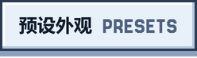</picture></a>&nbsp;
  <a href="#formats"><picture><source media="(prefers-color-scheme: dark)" srcset="assets/readme/key-formats-dark.png">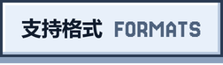</picture></a>&nbsp;
  <a href="#faq"><picture><source media="(prefers-color-scheme: dark)" srcset="assets/readme/key-faq-dark.png">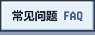</picture></a>&nbsp;
  <a href="#credits"><picture><source media="(prefers-color-scheme: dark)" srcset="assets/readme/key-credits-dark.png">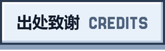</picture></a>
</p>

<p>
  <picture>
    <source media="(prefers-color-scheme: dark)" srcset="assets/readme/metrics-dark.png">
    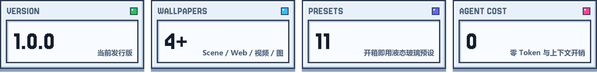
  </picture>
</p>

</div>

> [!NOTE]
> **原项目声明**：本项目移植并深度适配自 [`elysia395/dsh-wallpaper-engine`](https://github.com/elysia395/dsh-wallpaper-engine)（`dsh-plugin-wallpaper-engine`），Scene 场景实时渲染引擎由 [`oneincase/webwallgl`](https://github.com/oneincase/webwallgl) 驱动。详细出处与完整致谢请见文末 [原项目出处与致谢](#credits) 章节。

---

<h2 id="features"><picture><source media="(prefers-color-scheme: dark)" srcset="assets/readme/section-features-dark.png">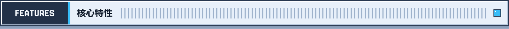</picture></h2>

<table>
  <tr>
    <td width="50%" valign="top">
      <h3>🎬 全格式本地壁纸直连</h3>
      自动扫描本机 Steam / Wallpaper Engine 创意工坊与自定义目录，实时渲染 <b>Scene / Web / Video / Picture</b> 壁纸，支持上传本地图片与视频，<b>无需在后台启动 Wallpaper Engine 客户端</b>。
    </td>
    <td width="50%" valign="top">
      <h3>🧊 iOS 风格液态玻璃外观</h3>
      支持对左右侧栏、对话卡片、输入框、弹窗独立开启液态玻璃，细调模糊度、透光率、遮罩深度、边框高光、独立四角圆角与主/次文字颜色，所见即所得。
    </td>
  </tr>
  <tr>
    <td width="50%" valign="top">
      <h3>🐾 吉祥物拉绳与交互特效</h3>
      右上角悬浮吉祥物拉绳快捷入口，内置 <b>10 款角色</b> 与自定义头像上传，支持点击波纹 / 火花、鼠标彗星拖尾与 3D 视差效果，拉一下即可唤醒壁纸库。
    </td>
    <td width="50%" valign="top">
      <h3>⚡ 零 Agent Token 开销 · 多插件共存</h3>
      纯本地 Loopback 媒体服务 + 渲染层注入，<b>不注册任何 MCP 工具、不注入提示词</b>；采用独立 1 行 ASAR 引导标记（<code>/* AGY_WE_HOOK_V1 */</code>），与 <code>antigravity-zh-cn</code> 汉化插件安全共存。
    </td>
  </tr>
</table>

<p align="center">
  <picture>
    <source media="(prefers-color-scheme: dark)" srcset="assets/readme/mascots-dark.png">
    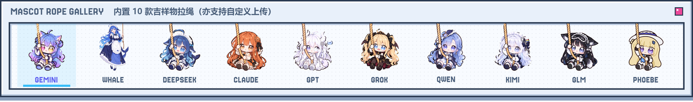
  </picture>
</p>

<h2 id="formats"><picture><source media="(prefers-color-scheme: dark)" srcset="assets/readme/section-formats-dark.png">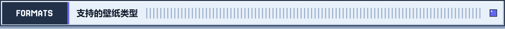</picture></h2>

| 壁纸类型 | 渲染方式 | 支持说明 |
| :--- | :--- | :--- |
| **Scene（场景）** | 内置 [`webwallgl`](https://github.com/oneincase/webwallgl) WebGL 实时渲染 | 支持帧率上限（15/30/60 FPS）与鼠标交互，失败时自动降级，**无需 WE 后台常驻** |
| **Web（网页）** | 本地沙箱挂载 + WE API 兼容层注入 | 独立 Loopback 端口隔离 CSP，支持交互式网页壁纸与自定义属性调节 |
| **Video（视频）** | 原生视频解码与 Range 流式播放 | 支持播放倍速、静音控制、窗口隐藏/遮挡自动暂停 |
| **Picture（图片 / 幻灯片）** | 本地直读与定时交叉轮播 | 读取图片目录并按设定周期平滑切换，文件全部留在本机 |
| **自定义上传** | 本地上传 JPG / PNG / WebP / MP4 | 所有文件仅保存在本机 `~/.antigravity-wallpaper-engine/uploads/`，不外传 |
| **Application（应用）** | ❌ 不支持 | 应用型壁纸依赖外部可执行程序，扫描与轮播时会自动过滤 |

<h2 id="presets"><picture><source media="(prefers-color-scheme: dark)" srcset="assets/readme/section-presets-dark.png">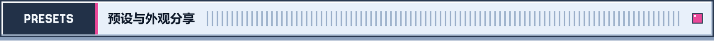</picture></h2>

本项目内置 **11 套开箱即用预设**，并额外附带作者自用的推荐预设文件，方便一键复刻同款 **冰透晶玻 + Gemini 拉绳** 观感：

| 预设文件 / 名称 | 来源 | 风格特点 |
| :--- | :--- | :--- |
| [**`presets/agy-wallpaper-preset.json`**](presets/agy-wallpaper-preset.json) | 作者自用预设 | **冰透晶玻 + Gemini 吉祥物拉绳**：青蓝高亮（`#75e6f5`）、9px 轻雾化、侧栏圆角 20px、高饱和背景增强 |
| `DeepSeek 冰透晶玻 (推荐)` / `高清原画` / `极简轻霜` / `深空冷霜` | 内置（`server/presets.mjs`） | 专为 Antigravity 2.0 布局调校的 4 套液态玻璃方案 |
| `factory-*` / `purple-mood` 等 7 套预设 | 上游（`server/upstream/presets/`） | 继承自原项目 `dsh-wallpaper-engine` 的经典外观预设 |

### 两种方式导入 `agy-wallpaper-preset.json`

1. **界面一键导入（推荐）**：在 Antigravity 中按 **`Ctrl + Alt + W`**（或下拉右上角吉祥物）打开壁纸面板 → 进入设置弹窗 → 点击 **「导入预设...」** → 选择仓库中的 [`presets/agy-wallpaper-preset.json`](presets/agy-wallpaper-preset.json) 即可立即生效并自动保存。
2. **文件目录放置**：将 [`presets/agy-wallpaper-preset.json`](presets/agy-wallpaper-preset.json) 复制到 `~/.antigravity-wallpaper-engine/presets/` 目录，重新打开面板即可在预设列表中选用。

<h2 id="start"><picture><source media="(prefers-color-scheme: dark)" srcset="assets/readme/section-start-dark.png">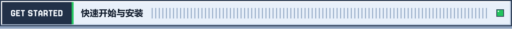</picture></h2>

### 前置条件

- **操作系统**：Windows 10 / 11
- **运行环境**：[Node.js](https://nodejs.org/) `>= 20.0.0`
- **宿主软件**：Antigravity 2.0 桌面端（可选：已安装 Steam 版 Wallpaper Engine 以自动扫描本地壁纸库）

### 三步安装

```powershell
# 1. 克隆仓库并安装依赖
git clone https://github.com/mugonk/antigravity-wallpaper-engine.git
cd antigravity-wallpaper-engine
npm install

# 2. 构建渲染层并同步到 Antigravity 插件目录
#    目标位置：~/.gemini/config/plugins/antigravity-wallpaper-engine
npm run sync

# 3. 注册开机更新守护并应用共存钩子
powershell -ExecutionPolicy Bypass -File "$env:USERPROFILE\.gemini\config\plugins\antigravity-wallpaper-engine\scripts\install.ps1"
```

> [!TIP]
> 如果运行 `install.ps1` 时提示 Antigravity 正在占用 `app.asar`，直接双击运行插件目录下的 **`scripts\应用壁纸插件并重启.cmd`**，脚本会自动关闭客户端、注入共存钩子并重新启动 Antigravity。

### 开始使用

- 按快捷键 **`Ctrl + Alt + W`**，或点击窗口右上角的 **吉祥物拉绳**，即可打开壁纸库与液态玻璃设置面板。
- 所有设置实时原子落盘在 `~/.antigravity-wallpaper-engine/config.json`，调整滑块与配色后**即时生效，无需重启**。

<h2 id="maintain"><picture><source media="(prefers-color-scheme: dark)" srcset="assets/readme/section-maintain-dark.png">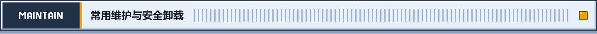</picture></h2>

```powershell
# 检查插件运行状态、钩子共存状态与壁纸库扫描诊断
npm run status

# 运行隔离自动化校验套件（服务端接口、安全边界、ASAR 共存与卸载）
npm test

# 修改源码后重新打包渲染层并同步到插件目录
npm run sync

# 安全卸载（请先完全退出 Antigravity）
powershell -ExecutionPolicy Bypass -File "$env:USERPROFILE\.gemini\config\plugins\antigravity-wallpaper-engine\scripts\uninstall.ps1"
```

> [!IMPORTANT]
> 卸载脚本仅精准移除 `/* AGY_WE_HOOK_V1 */` 这一行引导钩子及本插件的计划任务，**完全保留 `antigravity-zh-cn` 汉化等其他插件的钩子与配置**。

<h2 id="arch"><picture><source media="(prefers-color-scheme: dark)" srcset="assets/readme/section-arch-dark.png">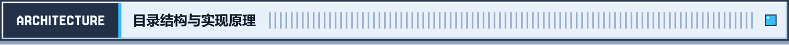</picture></h2>

<details>
<summary><b>点击展开完整目录结构与工作原理说明</b></summary>

```text
antigravity-wallpaper-engine/
├── assets/                   # 插件图标、10 款吉祥物拉绳与亮/暗双主题 README 视觉素材
│   ├── logo.svg
│   ├── rope/                 # 内置 10 款吉祥物拉绳 PNG
│   └── readme/               # 可复现的 README 双主题渲染脚本与视觉产物
├── presets/                  # 可直接导入分享的 JSON 外观预设
│   └── agy-wallpaper-preset.json
├── runtime/                  # Electron 主进程与渲染层注入
│   ├── hook.cjs              # 主进程钩子（拉起本地服务、放行 loopback CSP、热重载）
│   ├── bundle-renderer.mjs   # 渲染层打包脚本
│   ├── renderer.bundle.js    # 打包后的渲染层产物
│   └── renderer/             # 渲染层模块化源码（壁纸层、液态玻璃、视差特效、设置面板）
├── scripts/                  # 安装、卸载、ASAR 共存注入、状态诊断与一键重启脚本
├── server/                   # 本地 HTTP Loopback 媒体服务（端口动态分配）
│   ├── index.mjs             # 服务入口与 API 路由
│   ├── presets.mjs           # 预设加载与用户预设持久化
│   ├── settings.mjs          # 配置校验与原子落盘
│   ├── upstream/             # 复用自 dsh-wallpaper-engine 的扫描/解码/代理模块
│   └── webwallgl/            # WebWallGL Scene 渲染桥接层
├── skills/                   # Antigravity 插件管理技能文档
└── test/                     # 端到端自动化校验套件
```

**工作原理简述**：
1. `scripts/patch-asar.mjs` 在 `app.asar` 入口处以独立标记写入 1 行安全引导，加载 `runtime/hook.cjs`，并自动刷新 ASAR SHA256 完整性校验头。
2. Antigravity 启动后，`hook.cjs` 在本机 `127.0.0.1` 随机端口启动媒体服务，仅针对该本地回环地址放行必要 CSP，并向界面注入 `renderer.bundle.js`。
3. 所有状态与用户配置均保存在 `~/.antigravity-wallpaper-engine/` 下，完全独立于 Agent 对话链路。

</details>

<h2 id="faq"><picture><source media="(prefers-color-scheme: dark)" srcset="assets/readme/section-faq-dark.png">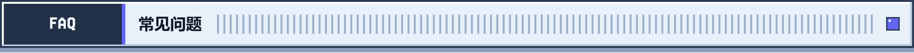</picture></h2>

<details>
<summary><b>1. 会和 <code>antigravity-zh-cn</code> 汉化插件冲突吗？</b></summary>

不会。本插件使用独立标记 `/* AGY_WE_HOOK_V1 */` 注入和移除钩子，运行 `npm run status` 可同时查看 `asar.wePatched` 与 `asar.zhCnPatched`，确认两者正常共存。
</details>

<details>
<summary><b>2. Antigravity 官方版本更新后壁纸消失了怎么办？</b></summary>

官方覆盖更新 `app.asar` 后，已注册的 `Antigravity-WE-AutoGuard` 守护任务会在下次登录时自动修复；您也可以随时双击 `scripts\应用壁纸插件并重启.cmd` 立即恢复。
</details>

<details>
<summary><b>3. 没有安装 Steam 版 Wallpaper Engine 也能用吗？</b></summary>

可以。打开壁纸库面板后，您可以直接上传本地图片（JPG / PNG / WebP）或视频（MP4），或在设置中指定自定义壁纸目录，所有液态玻璃、吉祥物拉绳、特效与字体功能均可正常使用。
</details>

<details>
<summary><b>4. 复杂 Scene 壁纸占用较高怎么办？</b></summary>

可在设置面板中将 **Scene 渲染帧率** 从 `60 FPS` 调低至 `30 FPS` / `15 FPS`，并保持开启 **窗口隐藏时自动暂停（`pauseOnHidden`）**，或开启失焦暂停以节省 GPU 资源。
</details>

<h2 id="credits"><picture><source media="(prefers-color-scheme: dark)" srcset="assets/readme/section-credits-dark.png">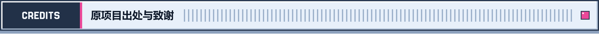</picture></h2>

本项目的诞生离不开以下优秀开源项目与社区开发者的工作，特此致以诚挚感谢 ❤️：

| 项目 | 作者 / 维护者 | 开源协议 | 在本项目中的作用 |
| :--- | :--- | :---: | :--- |
| [**`elysia395/dsh-wallpaper-engine`**](https://github.com/elysia395/dsh-wallpaper-engine) (`dsh-plugin-wallpaper-engine`) | [@elysia395](https://github.com/elysia395) 及全体贡献者 | MIT | **核心原项目出处**：本项目移植并适配自该仓库；承袭其 Steam/WE 壁纸库扫描、PKG/MP4 解析与流式服务、Web 沙箱兼容层、iOS 液态玻璃美学、经典预设与吉祥物拉绳素材 |
| [**`oneincase/webwallgl`**](https://github.com/oneincase/webwallgl) | [@oneincase](https://github.com/oneincase) | MIT | 提供浏览器端 Wallpaper Engine **Scene 场景壁纸 WebGL 实时渲染引擎** |
| **Jersey 20 Font** | The Soft Type Project Authors | [SIL OFL 1.1](assets/readme/OFL-Jersey20.txt) | 仅用于 [`assets/readme/generate.py`](assets/readme/generate.py) 生成 README 亮/暗双主题标题视觉素材，不作为插件运行时依赖 |

> 如果这个插件对您有帮助，也请顺手前往原项目 [**elysia395/dsh-wallpaper-engine**](https://github.com/elysia395/dsh-wallpaper-engine) 与 [**oneincase/webwallgl**](https://github.com/oneincase/webwallgl) 点一颗 ⭐ Star 支持原作者！

---

<div align="center">
  <p>
    本项目代码遵循 <a href="LICENSE">MIT License</a> 开源协议发布，完整保留上游原项目版权与许可声明。<br>
    壁纸、角色与字体素材的版权归各自原作者所有，再分发或商用前请自行核对相应授权。
  </p>
  <sub>Adapted for Antigravity 2.0 with ❤️ · Powered by <a href="https://github.com/elysia395/dsh-wallpaper-engine">dsh-wallpaper-engine</a> &amp; <a href="https://github.com/oneincase/webwallgl">webwallgl</a></sub>
</div>
